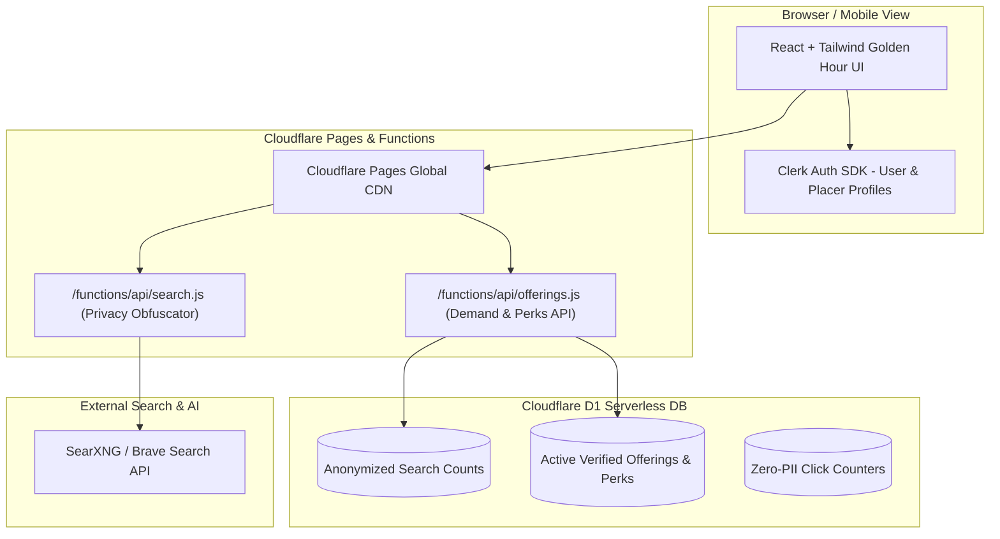

# Master Platform Blueprint: The Golden Hour Search & Offerings Engine
**"Where Search Meets Honest Value. Real Demand. Pure Perks. Zero Surveillance."**

---

## 1. Core Philosophy & Design Identity

### A. The "Offerings" Paradigm (Killing Intrusive Ads)
Traditional ads are interruptions designed to extract attention. This platform eliminates standard display/banner ads entirely and replaces them with **Verified Offerings**:
* **Every placement must offer tangible user value:** An active discount code, a manufacturer price break, free shipping voucher, or exclusive bundle perk. If a brand cannot provide a real discount or perk, it cannot place an offering.
* **Intent-Driven Funnel:** Placers only reach users who are actively in-market for their exact search keywords.
* **Mutual Value Exchange:** The user gets money saved and an honest preview; the offer placer gets a verified, warm buyer; the platform takes a transparent fee.

### B. The "Golden Hour" Aesthetic (White & Gold Theme)
A radiant, trustworthy, and premium visual identity inspired by sunlight and champagne warmth:

| Element | Color Token | Hex Code | Visual Feeling |
| :--- | :--- | :--- | :--- |
| **Canvas Background** | `bg-ivory` | `#FAF9F5` / `#FFFFFF` | Crisp, warm, paper-clean, non-fatiguing |
| **Surface Cards** | `bg-surface` | `#FFFFFF` | Pure white cards with soft amber shadow |
| **Primary Gold** | `gold-500` | `#D4AF37` / `#C5A028` | Prestigious, refined, authoritative gold |
| **Warm Amber Glow** | `amber-500` | `#F59E0B` | Radiant sunset accent for badges & CTAs |
| **Border Highlights** | `border-gold` | `rgba(212, 175, 55, 0.25)` | Subtle golden outline for verified items |
| **Typography (Headings)** | `text-obsidian` | `#18181B` | Deep contrast for absolute readability |
| **Typography (Muted)** | `text-sand` | `#71717A` | Elegant secondary slate/sand tone |

---

## 2. Global Site Structure & Navigation

The platform is anchored around two primary modes accessible in the top header:

```
┌────────────────────────────────────────────────────────────────────────┐
│  [☀️ Golden Hour / BookmarkSoft]    [ 🔍 Search ]  [ 🎁 Offerings ]     │
│                                    (Active Mode)   (Demand Tracker)    │
│                                                                        │
│  [ 🛡️ Shield: 100% Anonymized ]                   [ 👤 Clerk Auth ]   │
└────────────────────────────────────────────────────────────────────────┘
```

---

## 3. View 1: The Search Engine with "Sneak Peek" Offering Funnels

### A. Search Interface
* Clean, gold-accented search input with real-time intent suggestions.
* Slogan: *"Search Without Deception. Every Result Has Value."*
* Instant Anonymization Bar: Displays active privacy status (Client IP dropped, zero cookies).

### B. The Search Result Card with "Sneak Peek"
Next to every organic or merchant result title, a dedicated **Sneak Peek / View Offerings** button appears:

```
┌────────────────────────────────────────────────────────────────────────┐
│  KeyCraft 75% Wireless Mechanical Keyboard                             │
│  https://keycraft.example.com                                         │
│                                                                        │
│  [ ⚡ Sneak Peek & Offerings ] ◄── Interactive Drawer Trigger          │
│                                                                        │
│  Hot-swappable switches, gasket mount, aluminum volume knob...         │
└────────────────────────────────────────────────────────────────────────┘
```

### C. The Sneak Peek Funnel Drawer (Interactive Slide-Out)
When clicked, instead of redirecting the user or dropping tracking cookies, a sleek slide-out drawer or modal appears:
1. **Verified Discount Code:** e.g., `GOLDEN20` with a 1-click copy button.
2. **Live Value Breakdown:** Shows current retail price, discounted price, and shipping perks.
3. **Trust & Verification Badges:** Refund policy, customer rating, and manufacturer authenticity.
4. **Honesty Disclosure:** Explicitly notes: *"Why are you seeing this offering? Because you searched for 'mechanical keyboard'. Your data was not auctioned."*
5. **Direct Destination CTA:** Clean link opening the store in a secure, referrer-stripped new tab.

---

## 4. View 2: The Offerings Hub (Demand & Perks Tracker)

The **Offerings** view is an interactive marketplace connecting user search demand with brand offerings:

### A. Live Anonymous Demand Tracker ("What People Are Searching For")
* Aggregates real-time, anonymized search trends without user IDs:
  * *"382 people searched for 'ANC Headphones' this week"*
  * *"195 people searched for 'Developer Cloud VPS' today"*
  * *"140 people searched for 'Ergonomic Desk Accessories'"*

### B. Live Offerings Grid
* Users can browse the highest-value offerings currently placed for those search categories.
* Sort by: Highest Discount %, Newest Offerings, Staff Verified.

### C. For Brands & Offer Placers: "Place an Offering on Live Demand"
* Advertisers and brands can view what users are searching for and immediately place an offering for that specific keyword.
* **The Golden Rule:** Every offering must include a valid discount code or tangible perk.

---

## 5. System Architecture: Cloudflare Pages & Clerk



---

## 6. Cloudflare D1 Database Schema (Zero-Surveillance SQLite)

```sql
-- 1. Anonymous Search Demand (Aggregated counts, zero IPs or user IDs)
CREATE TABLE search_demand (
    keyword TEXT PRIMARY KEY,
    search_count INTEGER DEFAULT 1,
    category TEXT,
    last_searched_at TIMESTAMP DEFAULT CURRENT_TIMESTAMP
);

-- 2. Verified Brand Offerings
CREATE TABLE offerings (
    id TEXT PRIMARY KEY,
    brand_name TEXT NOT NULL,
    target_keyword TEXT NOT NULL,
    title TEXT NOT NULL,
    description TEXT NOT NULL,
    destination_url TEXT NOT NULL,
    coupon_code TEXT NOT NULL,
    discount_percentage INTEGER,
    fixed_price TEXT,
    original_price TEXT,
    status TEXT DEFAULT 'ACTIVE', -- ACTIVE, PAUSED, EXPIRED
    verified_perk TEXT,            -- e.g. 'Free Shipping', '20% Off'
    created_at TIMESTAMP DEFAULT CURRENT_TIMESTAMP
);

-- 3. Transparent Performance Metrics (Aggregated numbers only)
CREATE TABLE offering_metrics (
    offering_id TEXT PRIMARY KEY,
    sneak_peek_opens INTEGER DEFAULT 0,
    coupon_copies INTEGER DEFAULT 0,
    outbound_clicks INTEGER DEFAULT 0,
    FOREIGN KEY(offering_id) REFERENCES offerings(id)
);
```

---

## 7. Cloudflare Pages Functions: The Privacy Proxy (`/functions/api/search.js`)

This serverless function runs at Cloudflare edge data centers worldwide:

```javascript
export async function onRequestGet(context) {
  const { request } = context;
  const url = new URL(request.url);
  const query = url.searchParams.get('q');

  if (!query) {
    return new Response(JSON.stringify({ error: "Query is required" }), { status: 400 });
  }

  // 1. OBFUSCATION: Strip all client headers and IP
  const sanitizedQuery = encodeURIComponent(query.trim());

  // 2. Fetch neutral organic results from upstream engine without passing user IP
  const upstreamUrl = `https://api.search.brave.com/res/v1/web/search?q=${sanitizedQuery}`;
  
  const response = await fetch(upstreamUrl, {
    headers: {
      "Accept": "application/json",
      "X-Subscription-Token": context.env.BRAVE_SEARCH_API_KEY,
      "User-Agent": "TransparentSearchEngine/1.0" // Masked user agent
    }
  });

  const data = await response.json();

  // 3. Return clean JSON to client with zero tracking headers
  return new Response(JSON.stringify(data), {
    headers: {
      "Content-Type": "application/json",
      "Cache-Control": "public, max-age=120"
    }
  });
}
```

---

## 8. Implementation Steps for AI Studio

When you copy this plan into AI Studio:
1. **Set Theme Variables:** In `tailwind.config.js` or `index.css`, establish the White & Gold palette (`#FAF9F5`, `#D4AF37`, `#F59E0B`, `#18181B`).
2. **Create Dual-Mode Header:** Build the `[Search]` and `[Offerings]` toggle navigation.
3. **Build the Sneak Peek Funnel Component:** An inline drawer / popover that expands on search results to reveal coupons and verified pricing without leaving the page.
4. **Connect Cloudflare D1 & Pages Functions:** Deploy the schema to D1 and configure the edge functions.
5. **Connect Clerk:** Protect the Offerings creation flow with Clerk sign-in, while leaving the search and sneak-peek views 100% public and anonymous.
